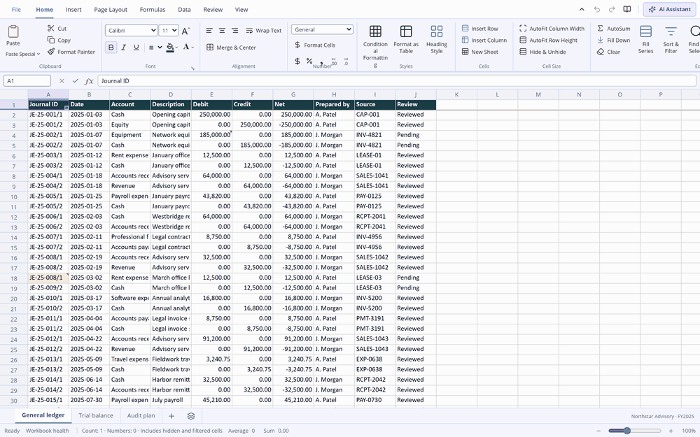
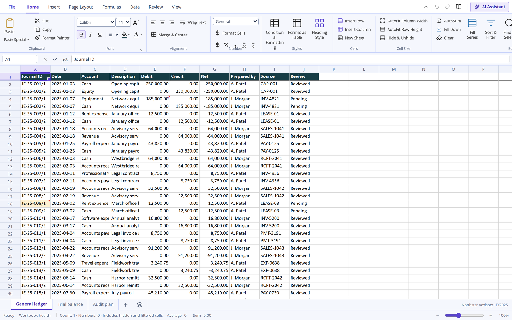
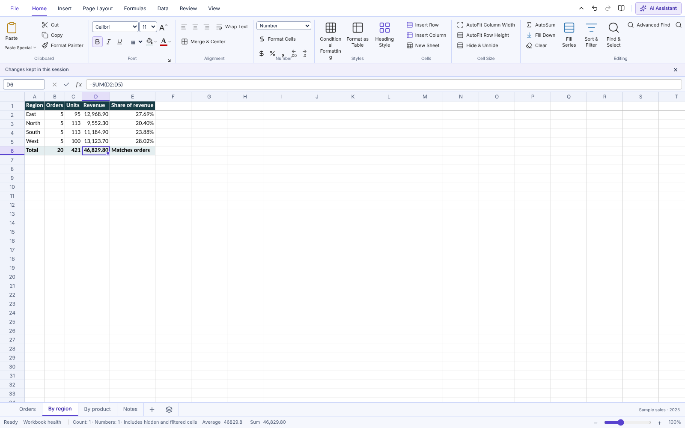
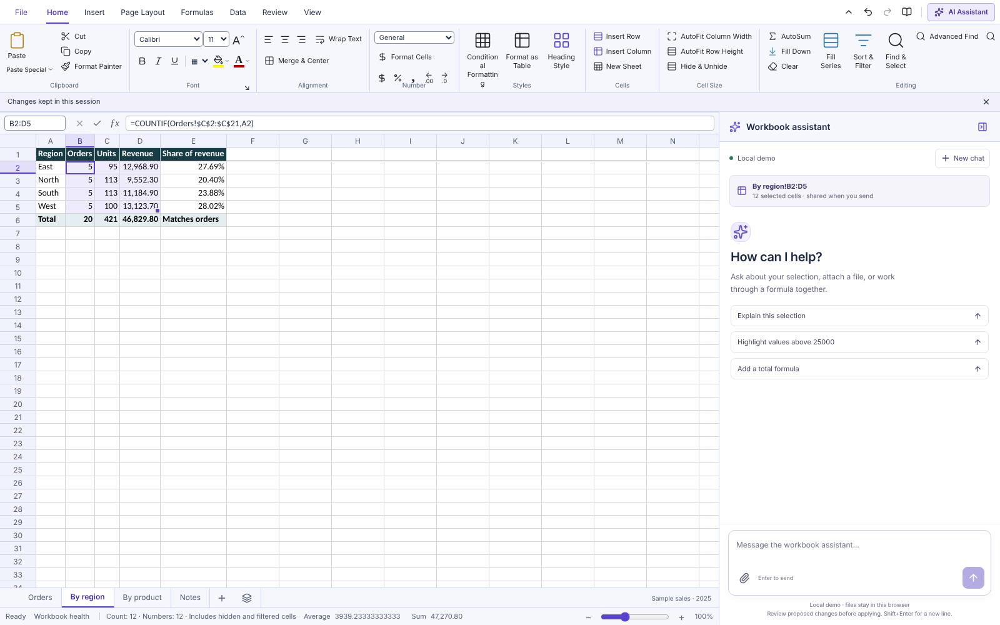
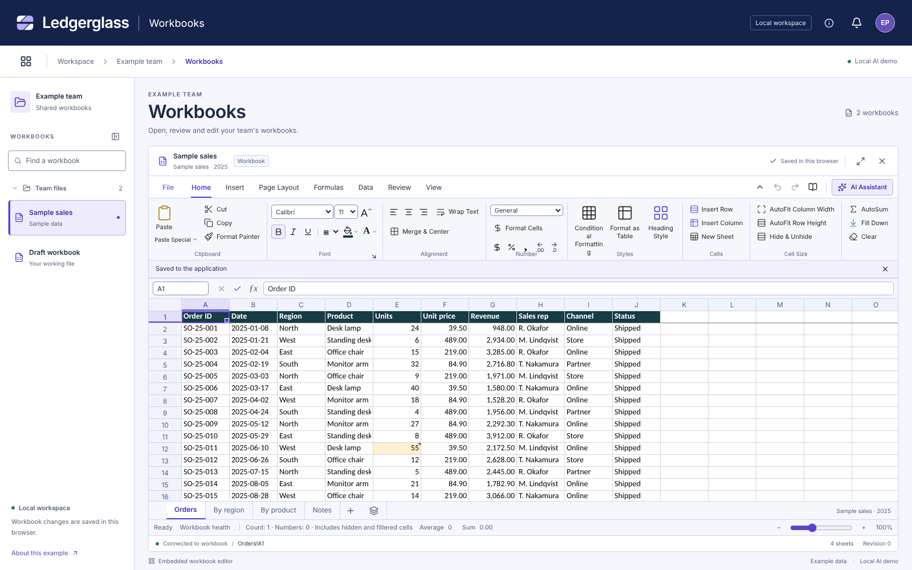
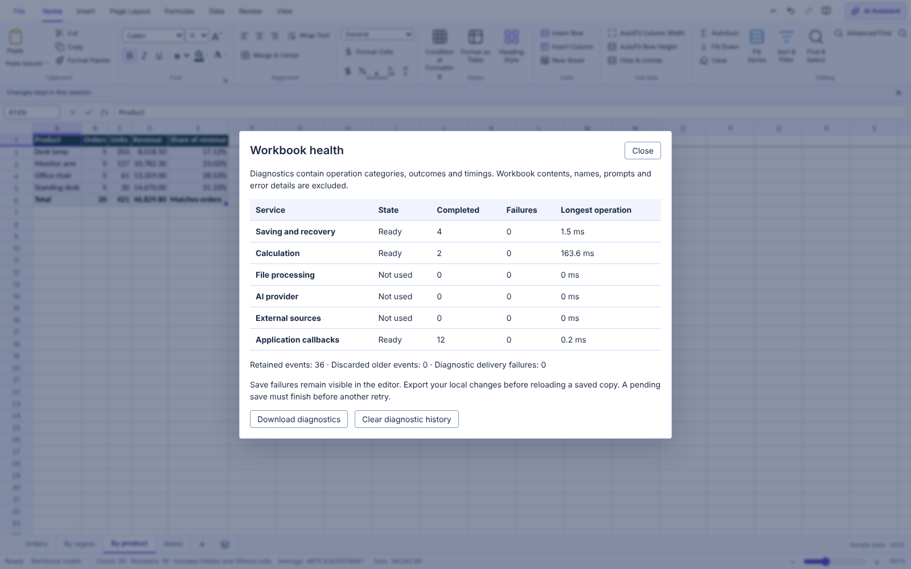
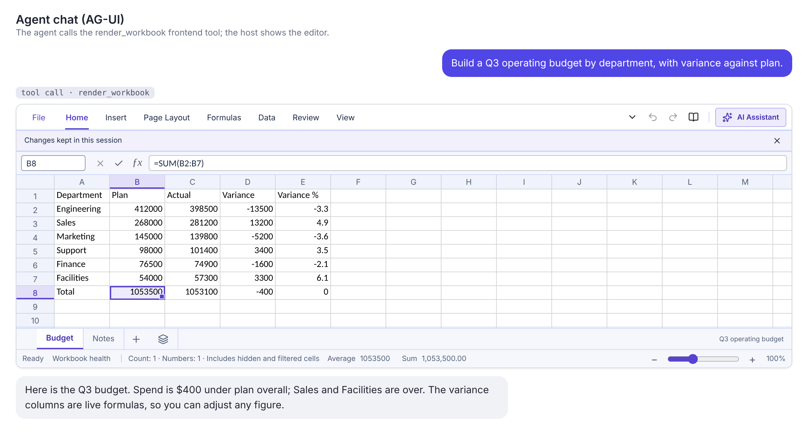
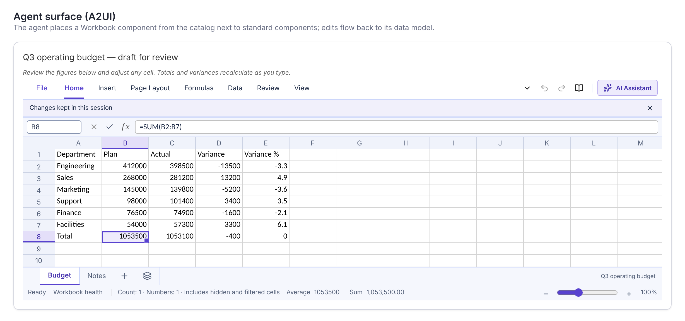

# Ledgerglass

**The open-source, Excel-style workbook you can run in the browser, embed in a larger web application and connect to any LLM.**

[](https://github.com/rbaran17/Ledgerglass/actions/workflows/ci.yml)
[](https://rbaran17.github.io/Ledgerglass/?demo)
[](LICENSE)

Ledgerglass is a React spreadsheet with an Excel-style ribbon, formula bar, grid and sheet tabs, and 395 worksheet functions calculated in the browser. Use it three ways:

- **Run it** as a standalone application: one HTML file, a static site, or a Docker container.
- **Embed it** in your own React application as a component.
- **Connect it to an LLM**: an assistant that proposes changes for review, an MCP server for one approved selection, and AG-UI / A2UI support so an agent can show a workbook itself.

**[Open the live demo](https://rbaran17.github.io/Ledgerglass/?demo)** (a synthetic audit workbook; nothing leaves your browser), or download [`Ledgerglass.html`](Ledgerglass.html), a single self-contained file, and open it in a desktop browser with `?demo` added to the address. The AI assistant needs a connected provider (see [AI assistant and MCP](#ai-assistant-and-mcp)).



<sub>The synthetic audit demo (<code>?demo</code>): a general ledger, a trial balance built with <code>SUMIF</code> across sheets,
live selection statistics, the workbook assistant scoped to the selected range, and the same workbook embedded in a host
application (<code>?embedded</code>).</sub>

> **Scope:** this is a substantial working implementation with documented limits, not full Microsoft Excel parity. Acceptance applies to the documented local scope; production, external-provider and independent accessibility acceptance remain separate.

> **Project status:** the original TypeScript source, SDK build, examples and most reference documents are not available. `src/` was recovered from the compiled application and reorganised into named modules; third-party libraries are imported from `node_modules`. The repository includes unit tests and browser checks. See [`src/README.md`](src/README.md) for the layout. Commands that run today include `npm run dev`, `npm run build`, `npm run build:portable`, `npm run build:container`, `npm start`, `npm run mcp`, `npm test` and `npm run test:e2e`.

## Screenshots

<table>
  <tr>
    <td width="50%"><br><sub><b>Workbook:</b> Excel-style ribbon, formula bar, grid and sheet tabs</sub></td>
    <td width="50%"><br><sub><b>Formulas:</b> trial balance totals that reconcile to zero</sub></td>
  </tr>
  <tr>
    <td><br><sub><b>AI assistant:</b> scoped to the selection; changes are proposed for review</sub></td>
    <td><br><sub><b>Embedded:</b> the editor inside a host application</sub></td>
  </tr>
  <tr>
    <td><br><sub><b>Workbook health:</b> diagnostics without workbook contents</sub></td>
    <td></td>
  </tr>
  <tr>
    <td><br><sub><b>Agent-rendered (AG-UI):</b> the agent calls the <code>render_workbook</code> tool and the host shows the editor</sub></td>
    <td><br><sub><b>Agent-rendered (A2UI):</b> the agent places a <code>Workbook</code> component on a surface; edits flow back to its data</sub></td>
  </tr>
</table>

<sub>The two agent screenshots come from a demo host that uses the official AG-UI client and A2UI React renderer with a scripted stand-in agent, not a live model. See [Showing a workbook from an agent](docs/AGENT-UI.md).</sub>

## Contents

- [Screenshots](#screenshots)
- [Quick start](#quick-start)
- [Capabilities](#capabilities)
- [Embedding](#embedding)
- [AI assistant and MCP](#ai-assistant-and-mcp)
- [Data, persistence and file exchange](#data-persistence-and-file-exchange)
- [Docker and scaling](#docker-and-scaling)
- [Limits and compatibility](#limits-and-compatibility)
- [Testing and validation](#testing-and-validation)
- [Repository layout](#repository-layout)
- [Documentation](#documentation)
- [Troubleshooting](#troubleshooting)
- [Contributing and licensing](#contributing-and-licensing)

## Quick start

### Run the prebuilt application

No install step is needed; the runtime uses Node built-ins only and serves the committed `dist/`.

```sh
npm start
```

Open **http://127.0.0.1:4173/** (add `?demo` or `?embedded`). Alternatively, open `Ledgerglass.html` directly in a desktop browser.

### Requirements

- Node.js **22.16 or later in the Node 22 family** and npm.
- A modern desktop browser. Browser APIs, clipboard, worker, storage and accessibility support must be validated in your target host.
- Docker Engine with Compose v2 only if you want to use the container setup.

From a checkout of this repository:

```sh
npm ci
npm run dev -- --port 4177
```

Open **http://127.0.0.1:4177/**. No model API key or backend service is required for the local demo.

| URL           | Experience                                                      |
| ------------- | --------------------------------------------------------------- |
| `/`           | Standalone workbook; opens blank or restores locally saved work |
| `/?embedded`  | Workbook inside the Test example application                    |
| `/?temporary` | Temporary workbook without browser persistence                  |
| `/?demo`      | Synthetic audit demonstration data                              |

### Build and run locally

```sh
npm run build:portable
npm start
```

Open **http://127.0.0.1:4173/**. `npm start` serves the previously built `dist/` directory; it does not compile the application.

The portable build also creates `Ledgerglass.html`, which includes the application code and styles and can be opened directly, and `Embedded-Workbook.html`, a small launcher that opens the same file in embedded mode (keep both in one folder). Local file storage and browser coordination vary by browser; localhost or HTTPS provides the more predictable experience. Export native JSON as a portable backup.

The prebuilt `dist/` and `Ledgerglass.html` are committed so the application can be tried without a build; installed dependencies are not included. `npm run build:portable` regenerates both.

## Capabilities

The links below document supported behavior and its boundaries; a feature family does not imply every feature of the equivalent Microsoft product.

| Area                     | Delivered capability                                                                                                                                                                                      |
| ------------------------ | --------------------------------------------------------------------------------------------------------------------------------------------------------------------------------------------------------- |
| Workbook lifecycle       | Create/open/save, sheet management, protection, revisions, undo/redo, recovery and concurrent-instance conflict handling                                                                                  |
| Familiar editing         | Keyboard navigation, multi-area selections, formula range selection, autocomplete after `=`, copy/cut/paste, fill, find/replace, freeze/split panes, outlines and row/column AutoFit                      |
| Formulas                 | 395 catalogued local function names; arithmetic, logic, lookup, text, date/calendar, financial, statistical/database families, dynamic arrays, names and reusable formulas within declared limits         |
| Calculation review       | Recalculation controls, dependency/error inspection, watches, evaluation steps, precision/date-system policies and bounded worker execution                                                               |
| Formatting and layout    | Cell/number styles, themes, conditional formatting, merges, pictures/shapes, page setup, print areas/titles, print preview and schedule PDF export                                                        |
| Tables and preparation   | Structured tables, calculated columns, safe sorting/filtering, saved views, validation, text cleanup/extraction, duplicate review, append/join and repeatable transformation recipes                      |
| Connections              | Registered external sources, reviewed single-source refresh and atomic Refresh All; server-side JSON/OData, SQLite, CSV/TSV folder and ODBC-compatible adapter contracts                                  |
| Models and analysis      | Relational models, a documented 20-function DAX subset, PivotTables, pivot filtering/drill-through, charts/sparklines, consolidation/subtotals, scenarios, Goal Seek and bounded Solver/statistical tools |
| Interoperability         | Native workbook JSON, XLSX, delimited files, supported structured sources, original-source retention, explicit export-loss reports and host adapters for alternate formats/document extraction            |
| Links and extensions     | Reviewed external-workbook snapshots, versioned custom-function/add-in adapters, reusable report outputs and bounded automation translation with inert unsupported source retention                       |
| Audit extensions         | Notes/tickmarks, evidence links, comparisons, aging/materiality screens, sampling and duplicate/gap/unusual-pattern checks; retained alongside base spreadsheet functionality                             |
| Assistant                | Chat built with assistant-ui, file staging/previews, history, Stop/Retry/Regenerate/Copy, selected-cell citations and explicit before/after proposal review                                               |
| LLM interoperability     | Local deterministic demo, provider-neutral HTTP/custom adapters and nine scoped MCP tools; proposals require human approval before cell changes                                                           |
| Collaboration            | Host-authorized shared editing contracts, conflict review, presence, discussions and offline recovery; production authority/storage/transport are host responsibilities                                   |
| Embedding and operations | Iframe embedding of the served application, browser/Node calculation integrations, parser workers, localization interfaces, diagnostics, stateless web container, Compose and Kubernetes templates        |

## Embedding

**As a React component.** `npm run build:lib` builds an ES module library into `lib/` that exports the editor (`AuditWorkbook`), the workbook model and the assistant protocol:

```jsx
import { AuditWorkbook, createBlankWorkbook } from "@ledgerglass/workbook";
import "@ledgerglass/workbook/style.css";

export function Workbook() {
  return (
    <div style={{ height: "80vh" }}>
      <AuditWorkbook initialWorkbook={createBlankWorkbook("Budget")} />
    </div>
  );
}
```

The library was rebuilt after the original SDK source was lost: its export names were chosen for the rebuild, its TypeScript declarations (`types/`) are hand-written for the public surface, and it is not published to a registry. `npm run test:lib` mounts the built library in a host page and drives it in a browser. See [Using Ledgerglass as a library](docs/LIBRARY.md) for the props, the assistant adapter contract and the model functions.

An AI agent can also show a workbook itself: as an AG-UI frontend tool (`render_workbook`) or as an A2UI catalog component (`Workbook`). `npm run test:agent-ui` checks both against the official AG-UI client and A2UI React renderer. See [Showing a workbook from an agent](docs/AGENT-UI.md).

**As an iframe.** The served application can be embedded if the host page's Content-Security-Policy and the `FRAME_ANCESTORS` setting allow it (see [Docker and scaling](#docker-and-scaling)). It is a visual embed; no general-purpose `postMessage` workbook API is supplied.

## AI assistant and MCP

### Connect your own model

The built-in assistant is a local deterministic demonstration; it does not call an LLM. A real model needs a host adapter that sends the selected context to your provider, keeps provider keys on the server and returns a proposal for review.

The chat supports text, CSV/TSV, JSON, PDF, DOCX, XLSX and common image attachments within explicit limits. The local demo acknowledges staged files but does not use an LLM to interpret them. The host must opt into chat, implement document handling and enforce authorization, request limits, scanning and retention. Responses currently complete as a single proposal; token streaming is not implemented.

### MCP server

The server gives a model nine tools over one host-approved selection: capability discovery, the selection's context, range reads, formula inspection and evaluation, the supported function list, a formula compatibility check, audit checks and proposal queuing. It cannot apply changes or widen the approved selection.

```sh
npm run mcp -- \
  --workbook /absolute/path/workbook.json \
  --sheet worksheet-id-from-native-json \
  --range A1:D20 \
  --outbox /absolute/path/proposals.json
```

The sheet argument is the stable JSON sheet ID, not its display name. Export a native workbook through File → Save workbook data. The input file and proposal outbox must be separate. No build step is needed: the server runs from `src/`.

This reference uses stdio and a file bridge. It does not synchronize an open browser window automatically or expose a public HTTP MCP endpoint. An embedding host connects its authorized workbook, proposal queue and review UI through `createWorkbookMcpServer` in `src/mcp/server.js`. See [MCP tools, configuration and integration](docs/MCP.md).

The server was rewritten after the original source was lost. It keeps the original entry point and the two tool names that survived (`workbook_get_context`, `workbook_get_capabilities`); the other seven tools were named and specified afresh.

## Data, persistence and file exchange

Native JSON preserves the application's workbook state, retained evidence and supported metadata more fully than exchange formats. XLSX import/export implements a documented subset, inventories unsupported original parts and reports losses when producing a derived file. Recovering an exact original is distinct from preserving every feature in an edited export.

CSV/TSV exchange includes delimiter/encoding/type review and formula-injection controls. Alternate formats and document extraction use explicit supported paths or host converters. Macro/source retention does not execute native VBA, Office Scripts, ActiveX or OLE code.

Browser local/session storage is useful for demonstrations and recovery, but is not a shared database or backup service. Production integrations need a revision-aware durable store, authorization, concurrency handling, backups and a verified restore process.

## Docker and scaling

### Local container deployment

```sh
docker compose up --build -d --wait --scale web=2
```

Open **http://127.0.0.1:8080/?embedded**. The Compose gateway balances requests across stateless web replicas.

```sh
docker compose down
```

Or build and run just the web image:

```sh
docker build --target web -t ledgerglass-workbook:0.1.0 .
docker run --rm --read-only --cap-drop ALL \
  --security-opt no-new-privileges:true \
  -p 127.0.0.1:8080:8080 ledgerglass-workbook:0.1.0
```

The `mcp` Docker target packages the scoped stdio server separately. The web image serves immutable assets with a non-root Node runtime, readiness/health endpoints, brotli and gzip support and graceful shutdown. It does not provide authentication, workbook database storage or a model proxy.

### Configuration

| Variable                     | Default                  | Purpose                                                             |
| ---------------------------- | ------------------------ | ------------------------------------------------------------------- |
| `LEDGERGLASS_PORT`           | `8080`                   | Compose localhost gateway port                                      |
| `HOST` / `PORT`              | `0.0.0.0` / `8080`       | Container HTTP listener                                             |
| `FRAME_ANCESTORS`            | `'self'`                 | Explicit allowed iframe parent origins                              |
| `CONNECT_ORIGINS`            | empty                    | Additional CSP connection origins; does not configure adapters/CORS |
| `SHUTDOWN_TIMEOUT_MS`        | `10000`                  | HTTP connection drain limit                                         |
| `NODE_IMAGE` / `NGINX_IMAGE` | See Docker/Compose files | Build/gateway image overrides; pin approved digests for releases    |

Example:

```sh
FRAME_ANCESTORS="'self' https://test.example.com" \
  docker compose up --build -d --wait --scale web=2
```

Kubernetes manifests include a two-replica Deployment, Service, disruption budget and HPA template for 2–10 replicas. Supply your registry image, namespace, TLS/ingress, Metrics API and platform policies. Scaling the asset server does not raise workbook limits or scale your database/model services. Shared backend state and retained assets across rolling releases require host implementation.

Container and cluster execution was **not verified** in the recorded local handoff. The included GitHub Actions workflow builds the web and MCP images and checks that the web image starts and serves the application; it does not publish images or deploy the application.

## Limits and compatibility

| Limit                        | Current local contract                                                  |
| ---------------------------- | ----------------------------------------------------------------------- |
| Worksheet address space      | 1,048,576 rows × 16,384 columns, through XFD1048576                     |
| Sheets                       | No fixed tab count; memory and workbook/file budgets apply              |
| Stored cells                 | **100,000 per workbook**, including formatting-only or note-only cells  |
| Cell/formula text            | 32,767 / 4,096 UTF-16 units                                             |
| Referenced formula rectangle | 20,000 cells; additional work/depth budgets apply                       |
| Dynamic array output         | 10,000 cells per array                                                  |
| Assistant context/proposal   | 500 selected cells / 500 proposed patches                               |
| XLSX/CSV/TSV import          | 10 MiB; archive expansion and parser budgets also apply                 |
| Native JSON save/reopen      | 50 MiB                                                                  |
| Chat attachments             | Up to four per message, 5 MB per file, 10 MB across request attachments |

Excel-sized addresses do not mean a fully populated Excel-sized worksheet can be processed. The limits above define the supported workload.

## Testing and validation

```sh
npm test                 # server tests, then unit tests
npm run test:deployment  # the static web runtime tests (Node built-ins only)
npm run test:unit        # core model, formulas and workers, in Node
npm run test:e2e         # browser checks against a build
npm run test:containers  # Docker build, replica and MCP startup checks (needs a Docker daemon)
```

The Playwright browser for `npm run test:e2e` may need a one-time install with `npx playwright install chromium`.

The Playwright config starts a development server on port 4173 and supports `CHROME_PATH`. Close any unrelated server on that port before testing. Container checks create and remove their own disposable Compose project; Kubernetes and actual provider acceptance require separate target environments.

GitHub CI runs the deployment-server tests, a dependency audit, the unit tests, a build with compressed assets followed by the browser checks in `tests/browser/`, and builds the web and MCP images.

## Repository layout

```text
src/
  main.js            Application entry point
  app/               Workbook editor modules (see src/app/README.md)
  assistant/         Assistant chat components
  workers/           Parser and calculation workers
  mcp/               Scoped MCP server (server.js, model.js)
  styles/            Application stylesheets
tests/
  browser/           Browser checks (Playwright)
  unit/              Unit tests (Vitest)
scripts/
  serve.mjs          Static server for dist/ (npm start)
  portable.mjs       Builds the portable HTML editions
  mcp-stdio.mjs     MCP server over stdio (npm run mcp)
  worker-source-plugin.mjs  Build plugin for worker sources
deploy/              Container runtime, health checks, nginx config, Kubernetes templates and tests
docs/LIBRARY.md      Building and embedding the library
docs/AGENT-UI.md     Letting an agent show a workbook (AG-UI and A2UI)
docs/MCP.md          MCP tools, configuration and integration
docs/assets/         Images used in this README
.github/workflows/   CI workflow
Dockerfile           Separate web and MCP build targets
compose.yaml         Local gateway and scalable web service
dist/                Committed production build
Ledgerglass.html     Committed portable application
Embedded-Workbook.html  Launcher for the embedded mode
```

`dist/`, `dist-container/`, portable HTML, and `node_modules/` are build outputs. `dist/` and the portable HTML are committed for convenience.

## Documentation

- **Source:** [src/README.md](src/README.md) (layout and recovery notes), [src/app/README.md](src/app/README.md) (editor modules).
- **Library:** [docs/LIBRARY.md](docs/LIBRARY.md) (building and embedding the React component, adapters and model functions).
- **Agent-rendered workbook:** [docs/AGENT-UI.md](docs/AGENT-UI.md) (AG-UI frontend tool and A2UI catalog component).
- **MCP:** [docs/MCP.md](docs/MCP.md) (tools, configuration and integration).
- **Docker:** [START-HERE-DOCKER.md](START-HERE-DOCKER.md) (container run and developer integration notes).
- **History and licensing:** [HISTORY.md](HISTORY.md) (earlier remediation checkpoints), [LICENSE](LICENSE) (MIT), [THIRD-PARTY-NOTICES.txt](THIRD-PARTY-NOTICES.txt) (dependency licenses).

## Troubleshooting

| Symptom                                       | Check                                                                                  |
| --------------------------------------------- | -------------------------------------------------------------------------------------- |
| `npm start` returns 404                       | `dist/` is missing or incomplete; run `npm run build`                                  |
| Worker or lazy chat load fails                | Preserve generated chunks/workers and review host asset paths/CSP                      |
| Blank or clipped embedded editor              | Give the parent element a definite height                                              |
| Iframe is blocked                             | Set `FRAME_ANCESTORS` to the exact authorized parent origin and serve over HTTPS       |
| Local demo does not interpret an uploaded PDF | Connect a host model/document adapter; the demo has no external model                  |
| Source refresh fails                          | Check source registration, authorization, supported formats and row/field/batch limits |
| Local file saves are unreliable               | Use localhost/HTTPS and export native JSON; verify browser storage support             |
| Large workbook is refused                     | Check stored-cell, file, archive and calculation budgets; split or reduce the input    |

## Contributing and licensing

Keep changes scoped and include relevant automated checks. Do not commit client data, model credentials, local workbooks or generated dependency folders.

Use your repository's approved private reporting channel for sensitive security findings. Production hosts must provide authentication, authorization, secret management, data retention and operational controls; client-side checks are not the security boundary.

The project is provided under the [MIT License](LICENSE). Dependency licenses are listed in [THIRD-PARTY-NOTICES.txt](THIRD-PARTY-NOTICES.txt). Microsoft Excel is referenced for workflow/compatibility context; Ledgerglass is an independent implementation and does not claim Microsoft affiliation.
