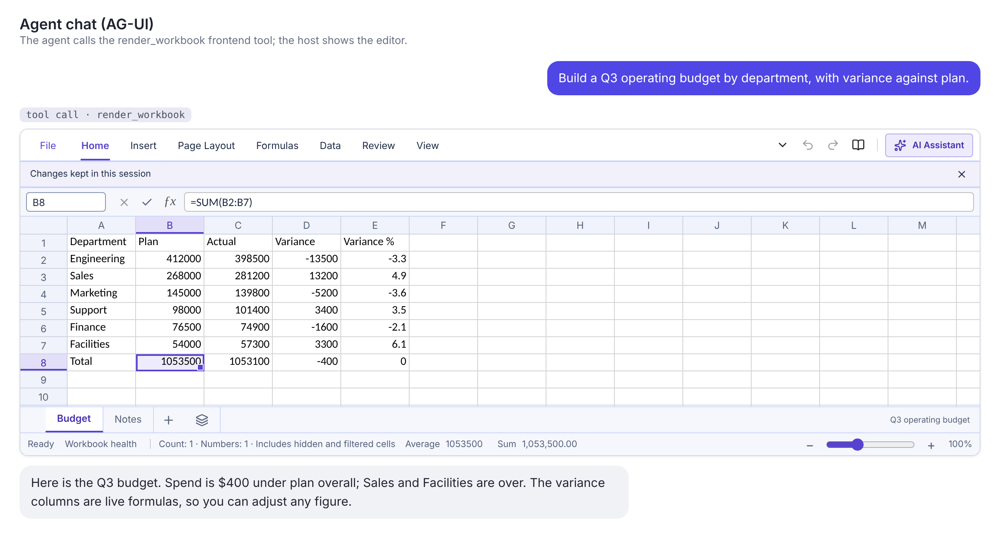
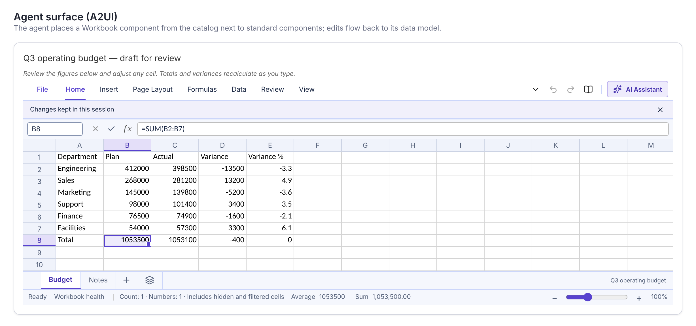

# Showing a workbook from an agent

An agent can show a workbook to the user in one of two ways. Through AG-UI, the agent calls a frontend tool named `render_workbook`, and the host application shows the workbook as the answer to that call. Through A2UI, the agent places a `Workbook` component on a surface, and the host's A2UI renderer shows it.

Ledgerglass does not depend on either protocol. The host application installs the AG-UI and A2UI packages and passes its own client, renderer and `zod` to the functions in this library. What the library provides is the workbook description format, the conversion from that description to a workbook, the tool and catalog definitions, and the editor component `AgentWorkbook`. The code is written against AG-UI 1.0 (`@ag-ui/client` 1.0.4) and A2UI 1.0 (`@a2ui/react` and `@a2ui/web_core`, version 0.15.0). `npm run test:agent-ui` checks it against those packages (section 6). The package is private and not published (see `docs/LIBRARY.md`); the examples import from `@ledgerglass/workbook` as a host application would.

| AG-UI: a tool call in a chat                                                                            | A2UI: a component on a surface                                                         |
| ------------------------------------------------------------------------------------------------------- | -------------------------------------------------------------------------------------- |
|  |  |

Both screenshots come from a demo host that uses the official AG-UI client and A2UI React renderer with a scripted stand-in agent, not a live model.

## 1. The workbook description

Both protocols carry the same description: a JSON object with a list of sheets. The table lists every field.

| Field                | Type          | Required | Meaning                                                                                                                              |
| -------------------- | ------------- | -------- | ------------------------------------------------------------------------------------------------------------------------------------ |
| `title`              | text          | no       | The workbook's name, shown in the editor. Text longer than 120 characters is cut to 120. Defaults to "Workbook".                     |
| `sheets`             | list          | yes      | The worksheets, in tab order. Between 1 and 20.                                                                                      |
| `sheets[].name`      | text          | yes      | Tab name. 1 to 31 characters, not containing `: \ / ? * [ ]`, and unique in the workbook (case does not matter).                     |
| `sheets[].rows`      | list of lists | no       | Cell values row by row, starting at `startCell`. The first row is usually the header.                                                |
| `sheets[].startCell` | text          | no       | Top-left cell of `rows`, such as `"B2"`. Defaults to `"A1"`.                                                                         |
| `sheets[].cells`     | object        | no       | Single cells by address, such as `{ "D7": "=SUM(D2:D6)" }`. Applied after `rows`, so a cell here replaces the same cell from `rows`. |
| `readOnly`           | boolean       | no       | `true` shows the workbook without allowing edits. Defaults to `false`.                                                               |

A cell value is one of these:

- A finite number. `NaN` and infinities are rejected.
- Text, up to 8,000 characters.
- `true` or `false`.
- `null` or `""`, which leaves the cell empty. In `cells`, `null` also clears a value that `rows` set.

Text that starts with `=` is a formula, for example `"=SUM(B2:B5)"`. Formulas use Excel syntax with A1 references, and the browser calculates them. A formula can produce an error such as `#DIV/0!`. The cell still shows the error, and the error is reported back to the agent (section 2).

The limits are in `workbookSpecLimits`:

| Limit                | Value                                 |
| -------------------- | ------------------------------------- |
| `maxSheets`          | 20                                    |
| `maxCells`           | 20,000 filled cells across all sheets |
| `maxTextLength`      | 8,000 characters per text cell        |
| `maxTitleLength`     | 120 characters                        |
| `maxSheetNameLength` | 31 characters                         |

Cell addresses must also fall inside the grid, which `workbookLimits` sets at 1,048,576 rows and 16,384 columns.

One description that the library accepts, with the budget used in the check:

```json
{
  "title": "Budget",
  "sheets": [
    {
      "name": "Plan",
      "rows": [
        ["Item", "Cost"],
        ["Rent", 1200],
        ["Food", 450]
      ],
      "cells": { "B4": "=SUM(B2:B3)", "C4": "=1/0" }
    }
  ]
}
```

B4 shows 1,650. C4 shows `#DIV/0!`.

Treat the description as untrusted data. The library checks it against the limits above and then reads it the same way as an imported file. A description that breaks a rule is not shown. `AgentWorkbook` shows a box that says the workbook could not be shown, followed by up to 20 reasons in plain words, for example `Sheet 2: the name may not contain : \ / ? * [ ].` The same reasons are in `WorkbookSpecError.problems`, in the `problems` of `readRenderWorkbookCall`, and in the argument of the `onInvalid` callback.

## 2. AG-UI: the `render_workbook` tool

AG-UI 1.0 defines frontend tools: the host lists the tool in `RunAgentInput.tools`, and when the agent calls it, the host runs the code. The example below follows the host used by the check.

```jsx
import { useEffect, useRef, useState } from "react";
import { HttpAgent } from "@ag-ui/client";
import {
  AgentWorkbook,
  createWorkbookToolSubscriber,
  renderWorkbookTool,
} from "@ledgerglass/workbook";
import "@ledgerglass/workbook/style.css";

export function AgentWorkspace() {
  const [shown, setShown] = useState([]);
  const agentRef = useRef(null);
  const pendingResults = useRef([]);

  useEffect(() => {
    const agent = new HttpAgent({ url: "/api/agent" });
    agent.subscribe(
      createWorkbookToolSubscriber({
        onWorkbook: (call) => {
          pendingResults.current.push(call.result);
          setShown((list) => [...list, call]);
        },
        onInvalid: (call) => {
          pendingResults.current.push(call.result);
        },
      }),
    );
    agentRef.current = agent;
  }, []);

  async function ask(text) {
    const agent = agentRef.current;
    for (const result of pendingResults.current.splice(0))
      agent.addMessage(result);
    agent.addMessage({ id: crypto.randomUUID(), role: "user", content: text });
    await agent.runAgent({ tools: [renderWorkbookTool] });
  }

  return (
    <div>
      <button onClick={() => ask("Show the budget as a sheet.")}>Ask</button>
      {shown.map((call) => (
        <AgentWorkbook
          key={call.toolCallId}
          spec={call.spec}
          workbookId={call.toolCallId}
          height={420}
        />
      ))}
    </div>
  );
}
```

In AG-UI 1.0 a frontend tool is answered in the messages of the next run, so `call.result` is added to the agent with `agent.addMessage` before the next `runAgent`. The result is a tool message with the call's `toolCallId`. When the workbook was shown, its `content` is JSON with `shown: true`, the workbook's `workbookId`, `title`, `sheets` (name, filled cells and formula count for each), `formulaErrorCount`, and `formulaErrors` (sheet, address, formula and error text, up to 25 entries). When the description was rejected, `shown` is `false`, `problems` lists the reasons, and the message's `error` is set. The agent can then read the formula errors and send a corrected workbook.

## 3. A2UI: the `Workbook` catalog component

A2UI 1.0 works through a catalog: the renderer advertises the catalog, and the agent places components from it on a surface. `createWorkbookCatalog` builds the catalog from the pieces the A2UI packages provide. The example follows the host used by the check.

```jsx
import { useEffect, useState } from "react";
import { z } from "zod/v3";
import { A2uiSurface, createComponentImplementation } from "@a2ui/react";
import { Catalog, CommonSchemas, MessageProcessor } from "@a2ui/web_core/v1_0";
import { basicCatalog } from "@a2ui/web_core/catalogs/basic/v1";
import { createWorkbookCatalog } from "@ledgerglass/workbook";
import "@ledgerglass/workbook/style.css";

const workbookCatalog = createWorkbookCatalog({
  Catalog,
  CommonSchemas,
  createComponentImplementation,
  z,
});

export function AgentSurfaces() {
  const [processor] = useState(
    () =>
      new MessageProcessor([basicCatalog, workbookCatalog], (action) => {
        sendActionToAgent(action); // your code: send the user's action to the agent
      }),
  );
  const [surfaces, setSurfaces] = useState([]);

  useEffect(() => {
    const sync = () =>
      setSurfaces(Array.from(processor.model.surfacesMap.values()));
    const created = processor.onSurfaceCreated(sync);
    const deleted = processor.onSurfaceDeleted(sync);
    return () => {
      created.unsubscribe();
      deleted.unsubscribe();
    };
  }, [processor]);

  return (
    <div>
      {surfaces.map((surface) => (
        <A2uiSurface key={surface.id} surface={surface} />
      ))}
    </div>
  );
}
```

Pass each batch of messages from the agent to `processor.processMessages(messages)` where the host receives them. Before the agent starts, the host can send `processor.getRendererCapabilities({ versions: ["1.0"] })`. Its `"1.0"` entry lists `supportedCatalogIds`, which includes `WORKBOOK_CATALOG_ID`.

The agent creates a surface, fills its data model, and places a `Workbook` on it. These are the messages the check sends, with the sales example's values:

```json
[
  {
    "version": "1.0",
    "createSurface": {
      "surfaceId": "s1",
      "catalogId": "https://github.com/rbaran17/Ledgerglass/blob/main/catalogs/workbook/v1/catalog.json"
    }
  },
  {
    "version": "1.0",
    "updateDataModel": {
      "surfaceId": "s1",
      "path": "/",
      "value": {
        "sheets": [
          {
            "name": "Sales",
            "rows": [
              ["Item", "Amount"],
              ["A", 10],
              ["B", 32]
            ],
            "cells": { "B4": "=SUM(B2:B3)" }
          }
        ]
      }
    }
  },
  {
    "version": "1.0",
    "updateComponents": {
      "surfaceId": "s1",
      "components": [
        {
          "id": "root",
          "component": "Workbook",
          "title": "Q3 sales",
          "sheets": { "@path": "/sheets" },
          "height": 420,
          "onChange": {
            "event": {
              "name": "workbook_changed",
              "context": { "sheets": { "@path": "/sheets" } }
            }
          }
        }
      ]
    }
  }
]
```

The `catalogId` value is `WORKBOOK_CATALOG_ID`. It is a name and nothing is fetched from it. To use a catalog of your own, pass `catalogId` in the options of `createWorkbookCatalog`.

The `Workbook` component has these properties:

| Property   | Type                         | Meaning                                                                                            |
| ---------- | ---------------------------- | -------------------------------------------------------------------------------------------------- |
| `title`    | text, or a data binding      | The workbook's name.                                                                               |
| `sheets`   | list of sheets, or a binding | The worksheets, in the form of section 1. Required. Bind it to a path to receive the user's edits. |
| `readOnly` | boolean, or a data binding   | `true` shows the workbook without allowing edits.                                                  |
| `height`   | number                       | Height in pixels. Defaults to 480, or the `height` option of `createWorkbookCatalog`.              |
| `onChange` | action                       | Sent to the agent after the user edits the workbook.                                               |

Two-way binding works when `sheets` is bound to a data model path, such as `{ "@path": "/sheets" }`. After each edit the component writes the edited sheets back to that path, each sheet as `{ name, cells }`, where `cells` holds the values by address and empty cells are left out. Then it sends `onChange`. In the check, the action's context carries the edited sheets, so the agent reads the user's change (B2 = 100) in the action. The write-back happens only when `sheets` is bound.

The agent side needs the catalog document, which lists the component and its instructions. `workbookCatalog.toJson()` returns it, with the `catalogId`, the `Workbook` schema and the instructions. The check reads it from the host page this way.

## 4. Sizing and editor props

`height` on `AgentWorkbook` is a number, read as pixels, or a text value, read as any CSS length such as `"60vh"`. It defaults to 480. The editor fills the frame, so the frame's height sets the editor's height.

Any other prop given to `AgentWorkbook` goes to the editor, as it does for `AuditWorkbook` (see `docs/LIBRARY.md`): for example `adapter`, `actor`, `onSelectionChange`, `onWorkbookLoaded`, `persistenceKey` and `workbookStore`. A `readOnly` prop overrides the `readOnly` of the description. The `editorProps` option of `createWorkbookCatalog` passes props the same way to every editor that the A2UI catalog renders.

To keep the user's edits in your own state, pass the description back. `onSpecChange` receives the edited description after each edit, and when the same description is passed back as `spec`, the editor does not rebuild the grid:

```jsx
const [spec, setSpec] = useState(call.spec);
<AgentWorkbook spec={spec} onSpecChange={(next) => setSpec(next)} />;
```

## 5. The zod version

A2UI 0.15 uses zod 3, while Ledgerglass depends on zod 4. Pass the zod 3 API to `createWorkbookCatalog`, which zod 4 ships as a subpath:

```js
import { z } from "zod/v3";
```

The check runs this combination. `createWorkbookCatalog` takes `z` as an argument; the library does not import zod for the catalog.

## 6. How it is checked

`npm run test:agent-ui` builds the library (`npm run build:lib`), installs the protocol packages into `tests/agent-ui-host` only, and runs `scripts/verify-agent-ui.mjs`. That script serves a small host page built from the library, drives it in a browser, and talks to a stand-in agent on a local server. The stand-in calls `render_workbook` with the budget description from section 1 and, once it receives the result, replies with a fixed sentence. The browser is Chromium through Playwright; set `CHROME_PATH` to use an installed Chrome.

The check passes these seven steps:

1. PASS A2UI: the renderer advertises the workbook catalog.
2. PASS A2UI: agent messages render a calculated workbook.
3. PASS A2UI: the user's edit reaches the data model and the agent's action.
4. PASS A2UI: a later agent update replaces the workbook.
5. PASS A2UI: a description that breaks the rules is explained.
6. PASS AG-UI: a `render_workbook` tool call shows the workbook.
7. PASS AG-UI: the next run carries the tool result, including the formula error.

The protocol packages are a test fixture with their own lockfile; they are not in the library's or the application's dependency tree. At the time of writing `npm audit` in `tests/agent-ui-host` reports one advisory that the fixture cannot remove: A2UI 0.15 requires zod 3, and the fix exists only in zod 4. The fixture pins a patched `dompurify` through an override.

The limits of the check are these:

- The agent is a stand-in with fixed replies, not a live model. The check does not show how a real model chooses to call the tool or what it does with the result.
- Only A2UI 1.0 through the official React renderer is covered. A2UI versions before 1.0, and other A2UI renderers (Lit, Angular, Flutter), are not covered.
- AG-UI is covered through `HttpAgent` with a server-sent event stream. Other transports are not covered.
